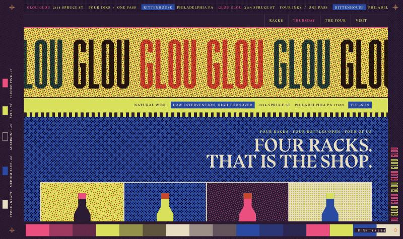
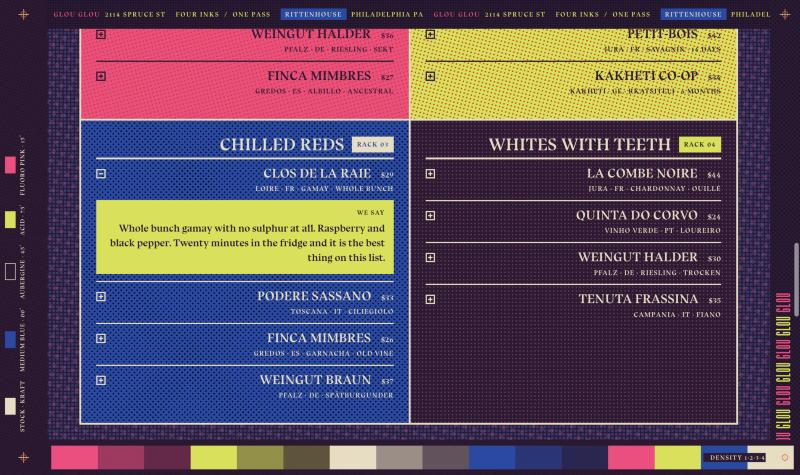
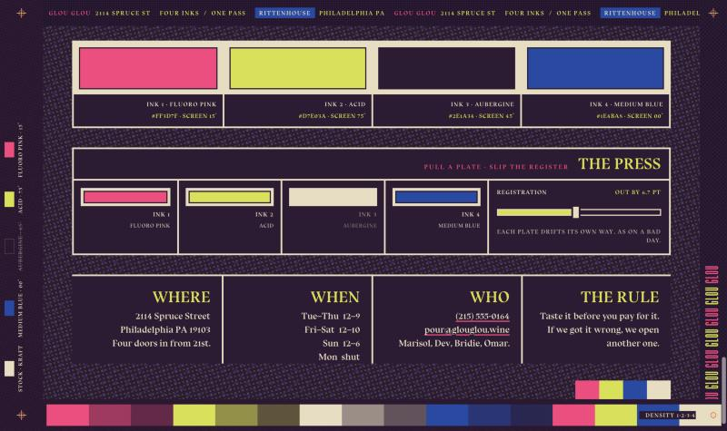

# GLOU GLOU

A four-ink risograph broadside for a natural wine shop on Spruce Street in Rittenhouse, Philadelphia.

**→ [noorbsharma21.github.io/glouglou](https://noorbsharma21.github.io/glouglou/)**

One page, one HTML file, no framework and no build step. The shop is invented; the printing is not.



---

## The idea

The page is built as a thing that was printed rather than a thing that was rendered. Four spot inks, one pass, on kraft stock. Everything follows from that: the halftone screens are real crossed rulings rather than a texture laid over the top, the frame carries the ink recipe the way a press sheet carries its colour bar, and the masthead runs past the trim and gets cut.

It is deliberately a single page — four sections and a colophon, no tabs, no router, nothing to click through before you reach the wine.

## What you can do with it

**Open any bottle.** All sixteen shelf rows expand into a tasting note. The note knocks out of the field onto flat ink, so the one piece of text you lean in to read has no screen behind it.



**Run the press.** The colophon has four plate toggles and a registration slider. Pull a plate and that ink's screens leave the page, its swatch knocks back to bare stock, and the recipe in the left frame strikes itself out — the frame never lies about what is on the press. Slip the register and every plate drifts its own way, as a job does on a bad day.

Only screens and display plates carry the slip, so you can run it fully out of register and every word you need to read stays exactly where it was.



**Thursday list.** The signup confirms in place.

Everything is keyboard reachable, buttons carry `aria-expanded` / `aria-pressed`, and the whole thing holds up under `prefers-reduced-motion`.

## The ink system

| | Ink | Hex | Screen |
|---|---|---|---|
| 1 | Fluoro pink | `#FF3D7F` | 15° |
| 2 | Acid | `#D7E03A` | 75° |
| 3 | Aubergine | `#2E1A34` | 45° |
| 4 | Medium blue | `#1E4BA8` | 0° |
| — | Kraft stock | `#E9DCC0` | — |

A screen is two rulings crossed at ninety degrees and turned to the ink's angle: one laid down as ink, one cut as a mask, the whole thing composited with `mix-blend-mode: multiply`. Where the two rulings cross, ink sits on the stock. It tiles seamlessly at any angle and needs no oversized rotated layer, which an earlier version used and which could not cover extreme aspect ratios without leaving a diagonal seam.

## Two things worth knowing

**A screen cannot run under small type.** At 11px, 2.2px dots hold and 3px dots do not — the dots are the size of the stems and the letterforms lose their edges. No contrast ratio predicts this, because ratio measures value and the problem is frequency. Where type had to sit in a screened field, the screen knocks out behind it instead.

**Four inks need four grounds.** Aubergine and blue do double duty here as both drawing inks and dark grounds, so marks drawn in them kept disappearing into themselves — the aubergine bottle on the blue field measured 1.52:1. Each was given a ground it could sit on rather than being recoloured away. The recipe patches are keylined for the same reason: no single ground serves four inks spanning that much luminance, so the patch edge is defined at 11.8:1 whatever the ink while the ink itself is still shown undistorted.

## Type

Two libre faces from [Velvetyne](https://velvetyne.fr/), loaded from the foundry's own repositories via jsDelivr and pinned to commits. Neither is redistributed here.

- **[BluuNext](https://github.com/velvetyne/BluuNext)** — a bold serif with real flavour. Carries display, names, labels and running text.
- **[Commune Nuit Debout](https://github.com/velvetyne/Commune-Nuit-Debout)** by Sébastien Marchal — condensed and curveless, drawn for protest posters. Used only where type is set huge.

Both OFL. Two others were tried and dropped on coverage rather than taste: Format 1452 has no É or Ä and renders the middot this label system runs on as a notdef circle, and Nuit Debout went wispy below about 14px.

## Running it

No dependencies, no install. Open `index.html`, or:

```bash
node serve.js
```

Then visit `http://localhost:4175`. The only network requests the page makes are the two webfonts.

## Licence

Code is MIT, see [LICENSE](LICENSE). The typefaces are under the SIL Open Font Licence and belong to their designers; they are linked, not bundled. GLOU GLOU is a fictional shop — the address, phone number and wine list are invented. Full terms in [NOTICE](NOTICE).
